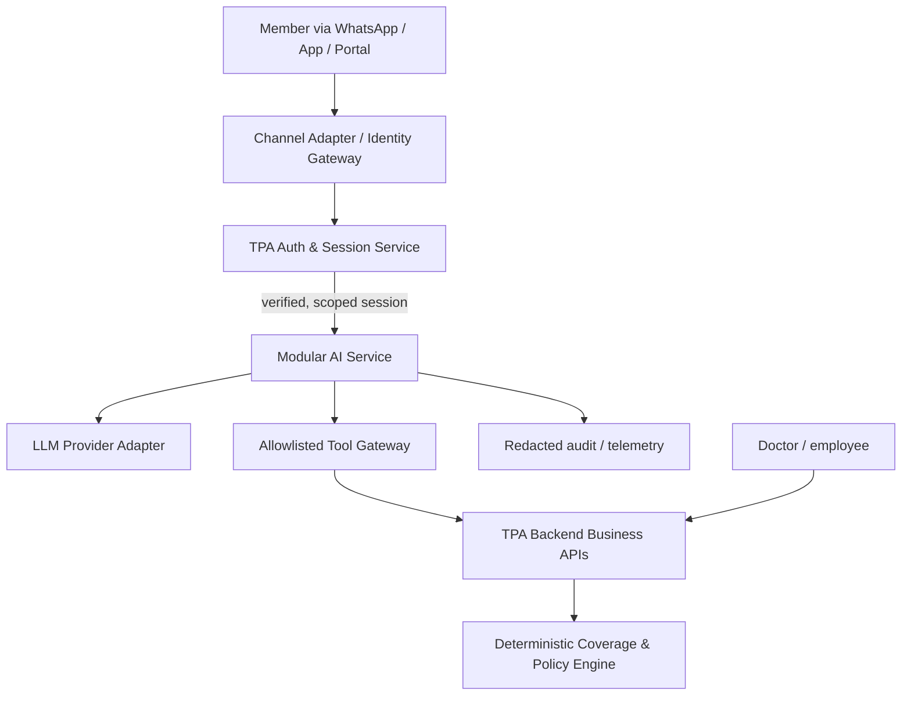

# TPA AI Service — In-House AI Layer

> **Status:** Discovery / architecture baseline (V0.1). **Not production-ready.**  
> **Last updated:** 2026-11-22. **GitHub repository:** [`Nagy-API/TPA-AI-Euro`](https://github.com/Nagy-API/TPA-AI-Euro).  
> **Visibility:** PRIVATE (verified 2026-11-22). Do not add real patient data or credentials.

## المشروع باختصار

ده الـAI Layer المقترح لمنصة Third-Party Administrator (TPA) للتأمين الطبي. بنتعلم ونبني بالتوازي؛ بنستخدم Coding Agents في التنفيذ لكن القرارات، الـArchitecture، والاختبارات مسؤوليتنا.

**أول هدف قابل للتسليم:** Policy-aware member assistant مع هوية موثقة وCoverage Lookup باستخدام Mock Backend، ثم real integration بعد اتفاق الفريق على الـAPI contracts.

## Product intent

The full TPA platform may include insurers, corporate clients, groups, plans, member eligibility, benefits, provider network, approvals, claims, and dashboards. **This repository is ONLY the AI layer** and its contracts and test assets, not the full core TPA platform.

Initial proposed AI responsibilities:
- Member-facing policy-aware assistant, chat routing, and supported tool use.
- Document extraction (later), human-reviewed clinician summaries (later).
- Knowledge retrieval over approved, versioned documents (later).
- Operational insights / anomaly detection (future, separate scope).

**Non-responsibilities:** medical approval/rejection; claims adjudication; policy calculation; identity authorization; direct database access; independent changes to member records.

## Start here (for humans or a new AI agent)

Read these files **in order**:

1. [`PROJECT_STATUS.md`](PROJECT_STATUS.md) — latest actual status, verified work, blockers, next action.
2. [`HANDOFF.md`](HANDOFF.md) — what another chat or agent must know.
3. [`AGENTS.md`](AGENTS.md) — how to work with Nagy, safety and evidence rules.
4. [`docs/architecture.md`](docs/architecture.md) — system boundaries and technical decisions.
5. [`docs/member-identity.md`](docs/member-identity.md) — authentication gate before AI.
6. [`docs/api-contracts.md`](docs/api-contracts.md) — first proposed REST contracts, errors.
7. [`ROADMAP.md`](ROADMAP.md) — incremental milestones and acceptance criteria.
8. [`docs/first-vertical-slice.md`](docs/first-vertical-slice.md) — first end-to-end implementation plan.
9. [`docs/diagrams/`](docs/diagrams/) — editable Mermaid diagrams.

## Current architecture (proposed)

**Core rule:** verified session comes from trusted backend, NOT a member ID picked by an LLM. Data retrieved for each question must be minimal and appropriately authorized. The LLM drafts explanations, not medical/financial decisions.

## Stack direction (subject to team agreement)

- TypeScript + Node.js (proposed due to prior prototype's Node.js role split).
- Official provider SDK, simple function/tool calls before agent frameworks.
- Zod for boundaries; Vitest for tests; Docker when service code starts.
- LLM provider **not chosen**. Compare models against Arabic TPA evaluation cases, data-processing constraints, latency and price.
- Do not introduce a vector database, LangChain, microservices, or OCR service without a demonstrated use case.

## Scope and sources

The initial planning inputs were: (1) user-shared TPA AI proposal dated 2026-11-21, (2) three WhatsApp voice notes (Nov 21–22), (3) Limitless Care corporate profile shared as a **benchmark**, and (4) the team-created TPA AI In-House Hub: https://qr.euro-assist.com/TPA_Prototype/index.html. Prototype landing-page claims are **not verified code features**. Source files are intentionally not copied here and may include confidential data. All scope estimates and requirements need confirmation with product/domain owners.

## What is not done

No live backend integration, no actual LLM endpoint, no user accounts, no live OTP delivery, no production data, no deployed app, no security certification, and no passing test suite are claimed at this stage.

## Workflow and reporting

- Every meaningful change should update `PROJECT_STATUS.md` and append to `docs/CHANGELOG.md`; design changes get a new ADR in `docs/decisions/`.
- Work on short-lived branches/PRs; no production deploy, destructive migration, branch deletion, force push, or secret rotation without Nagy's explicit approval.
- Report what changed, commands run, results, what remains unverified, and next action. No fabricated evidence.
- For requests to resume, **read `HANDOFF.md` and `PROJECT_STATUS.md` first**, then inspect repository status and commit history.

## Success criterion for first vertical slice

A member can identify and verify through trusted backend/mock; a scoped session is established; an Arabic coverage question triggers an allowlisted read-only tool; tool results drive an accurate answer; inaccessible or uncertain data leads to safe clarification/escalation. Test happy path, invalid member, wrong OTP, rate limit, cross-member attempt, unavailable API, and misleading prompt.

## Repository checks

Run `python scripts/validate_repository.py` to check local Markdown links, code fences, JSON and eval definitions; GitHub Actions runs the same sanity check on PRs and pushes to `main`. **This does not prove the application works**, and no LLM/backend integration exists yet.
