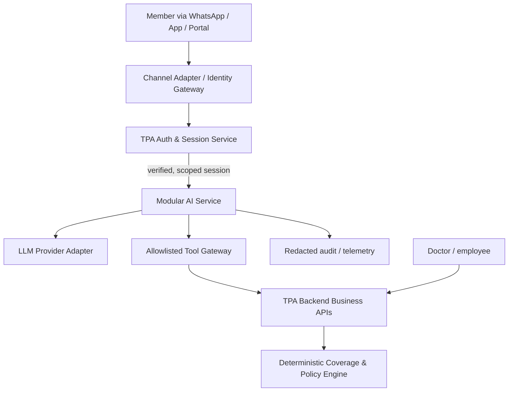

# TPA AI Service — In-House AI Layer

> **Status:** Local offline member verification and coverage demo (V0.1). **Not production-ready.**
>
> **Last updated:** 2026-11-23. **GitHub repository:** [`Nagy-API/TPA-AI-Euro`](https://github.com/Nagy-API/TPA-AI-Euro).
>
> **Visibility:** PUBLIC (verified 2026-11-23). Do not add real patient data, internal-only artifacts or credentials.

## المشروع باختصار

ده الـAI Layer المقترح لمنصة Third-Party Administrator (TPA) للتأمين الطبي. بنتعلم ونبني بالتوازي؛ بنستخدم Coding Agents في التنفيذ لكن القرارات، الـArchitecture، والاختبارات مسؤوليتنا.

**أول هدف قابل للتسليم:** Policy-aware member assistant مع هوية موثقة وCoverage Lookup باستخدام Mock Backend، ثم real integration بعد اتفاق الفريق على الـAPI contracts.

## Product intent

The full TPA platform may include insurers, corporate clients, groups, plans, member eligibility, benefits, provider network, approvals, claims, and dashboards. **This repository is ONLY the AI layer** and its contracts and test assets, not the full core TPA platform.

Initial proposed AI responsibilities:
- Member-facing policy-aware assistant, chat routing, and supported tool use.
- Document extraction (later), human-reviewed clinician summaries (later).
- Knowledge retrieval over approved, versioned documents (later).
- Operational insights / anomaly detection (future, separate scope).

**Non-responsibilities:** medical approval/rejection; claims adjudication; policy calculation; identity authorization; direct database access; independent changes to member records.

## Start here (for humans or a new AI agent)

Read these files **in order**:

1. [`PROJECT_STATUS.md`](PROJECT_STATUS.md) — latest actual status, verified work, blockers, next action.
2. [`HANDOFF.md`](HANDOFF.md) — what another chat or agent must know.
3. [`AGENTS.md`](AGENTS.md) — how to work with Nagy, safety and evidence rules.
4. [`docs/architecture.md`](docs/architecture.md) — system boundaries and technical decisions.
5. [`docs/member-identity.md`](docs/member-identity.md) — authentication gate before AI.
6. [`docs/api-contracts.md`](docs/api-contracts.md) — first proposed REST contracts, errors.
7. [`ROADMAP.md`](ROADMAP.md) — incremental milestones and acceptance criteria.
8. [`docs/first-vertical-slice.md`](docs/first-vertical-slice.md) — first end-to-end implementation plan.
9. [`docs/diagrams/`](docs/diagrams/) — editable Mermaid diagrams.

## Current architecture (proposed)



**Core rule:** verified session comes from trusted backend, NOT a member ID picked by an LLM. Data retrieved for each question must be minimal and appropriately authorized. The LLM drafts explanations, not medical/financial decisions.

## Stack direction (subject to team agreement)

- TypeScript + Node.js (proposed due to prior prototype's Node.js role split).
- Official provider SDK, simple function/tool calls before agent frameworks.
- Zod for boundaries; Vitest for tests; Docker when service code starts.
- LLM provider **not chosen**. Compare models against Arabic TPA evaluation cases, data-processing constraints, latency and price.
- Do not introduce a vector database, LangChain, microservices, or OCR service without a demonstrated use case.

## Scope and sources

The initial planning inputs were: (1) user-shared TPA AI proposal dated 2026-11-21, (2) three WhatsApp voice notes (Nov 21–22), (3) Limitless Care corporate profile shared as a **benchmark**, and (4) the team-created TPA AI In-House Hub: https://qr.euro-assist.com/TPA_Prototype/index.html. Prototype landing-page claims are **not verified code features**. Source files are intentionally not copied here and may include confidential data. All scope estimates and requirements need confirmation with product/domain owners.

## What is not done

Live TPA and model integrations, real member authentication, OTP delivery, and production security validation are pending.

## Workflow and reporting

- Every meaningful change should update `PROJECT_STATUS.md` and append to `docs/CHANGELOG.md`; design changes get a new ADR in `docs/decisions/`.
- Work on short-lived branches/PRs; no production deploy, destructive migration, branch deletion, force push, or secret rotation without Nagy's explicit approval.
- Report what changed, commands run, results, what remains unverified, and next action. No fabricated evidence.
- For requests to resume, **read `HANDOFF.md` and `PROJECT_STATUS.md` first**, then inspect repository status and commit history.

## Success criterion for first vertical slice

A member can identify and verify through trusted backend/mock; a scoped session is established; an Arabic coverage question triggers an allowlisted read-only tool; tool results drive an accurate answer; inaccessible or uncertain data leads to safe clarification/escalation. Test happy path, invalid member, wrong OTP, rate limit, cross-member attempt, unavailable API, and misleading prompt.

## Repository checks

Run `python scripts/validate_repository.py` to check local Markdown links, code fences, JSON and eval definitions. GitHub Actions is configured to run the same check on PRs and pushes to `main`. See [CI diagnostics](docs/ci-diagnostics.md) for the resolved historical runner blocker and current checks.

## First working slice (merged into `main`; demo-only, not production)

A real, runnable **demo** implementation is under `src/` with no runtime npm dependencies:

- `/health` reports demo status (not production readiness).
- `POST /v1/member-auth/challenges` starts identification. `POST /v1/member-auth/challenges/{challengeId}/verify` checks the public mock OTP and issues a member- and tenant-scoped session with a ten-minute lifetime. `POST /v1/member-auth/logout` revokes it.
- `POST /v1/chat` requires that session token in the `x-demo-session` header. Member and tenant scope come from the verified session. Request fields and chat text cannot override it.
- `ClaudeIntentSelector` uses the Anthropic Messages HTTP API tool-use response to pick **one** allowed service code (MRI/CBC/XRAY), with no member ID in tool input.
- A mock backend returns member-scoped deterministic coverage. Output is rendered by a **deterministic formatter**, not free-form LLM drafting, to prevent hallucinated co-pay/limits/approvals.
- `DemoKeywordSelector` is an explicitly **non-AI offline substitute** for local development and tests.

### Run without an API key (non-AI offline demo)

Requires Node.js 22.16+. The verified demo uses public mock codes, in-memory sessions, synthetic coverage, and deterministic keyword matching. It binds to `127.0.0.1` and refuses to start with `NODE_ENV=production`. Run directly on loopback and use only fictional data.

```powershell
$env:ENABLE_DEMO_AUTH = 'true'
$env:DEMO_AUTH_MODE = 'verified'
$env:DEMO_INTENT_MODE = 'fixture'
npm run dev
```

In a second PowerShell terminal, start a challenge for the fictional Gold member, verify the public code `135790`, and ask about MRI coverage:

```powershell
$demoUrl = 'http://127.0.0.1:3000/v1'
$challenge = Invoke-RestMethod -Method Post -ContentType 'application/json' -Uri "$demoUrl/member-auth/challenges" -Body '{"memberIdentifier":"M-DEMO-001"}'
$verifyUrl = "$demoUrl/member-auth/challenges/$($challenge.challengeId)/verify"
$verified = Invoke-RestMethod -Method Post -ContentType 'application/json' -Uri $verifyUrl -Body '{"oneTimeCode":"135790"}'
$headers = @{ 'x-demo-session' = $verified.sessionToken }
$question = '{"message":"Is MRI covered?"}'
Invoke-RestMethod -Method Post -ContentType 'application/json' -Uri "$demoUrl/chat" -Headers $headers -Body $question
Invoke-RestMethod -Method Post -Uri "$demoUrl/member-auth/logout" -Headers $headers
```

Expect HTTP 202 for identification, 200 for verification, and 200 `COVERAGE_RESULT` for the chat reply. The Gold fixture response reports «نسبة التحمل: 20%. الحد المتبقي: 5,000 جنيه.» and requires preapproval. The same chat request after logout returns 401 `VERIFICATION_REQUIRED`. A wrong or replayed code returns 401 `VERIFICATION_FAILED`. For other fictional members and challenge limits, see the [demo auth runbook](src/demo-auth/README.md).

The fixed `demo-gold-session`, `demo-silver-session`, and `demo-vip-session` tokens are available only with explicit `DEMO_AUTH_MODE=legacy`. Legacy mode offers chat without challenge routes.

### Later: Run with Claude tool-use (DEFERRED until Nagy approves cost)

```bash
ENABLE_DEMO_AUTH=true DEMO_AUTH_MODE=legacy DEMO_INTENT_MODE=claude ALLOW_PAID_LLM=true npm run dev
```

Verified mode accepts only the offline fixture selector. The deferred provider experiment requires legacy mode, `DEMO_INTENT_MODE=claude`, `ALLOW_PAID_LLM=true`, and locally configured `ANTHROPIC_API_KEY` and `ANTHROPIC_MODEL`. Keep credentials out of Git and chat. The adapter receives the question and public fictional service catalog. Use synthetic questions only, pending data-handling approval and a PII minimization design.

This integration calls the documented Anthropic Messages HTTPS endpoint directly for now, with a small replaceable adapter; migrating to the official SDK is a planned follow-up. **No real Claude call is claimed as verified** without credentials and measured outputs. Official tool-use docs: https://platform.claude.com/docs/en/agents-and-tools/tool-use/how-tool-use-works

### Test

```bash
npm test
python scripts/validate_repository.py
```

No `npm install` is needed for the zero-dependency demo. Node.js TypeScript stripping executes code but does **not** type-check it; type-checking was performed locally using TypeScript 5.8.3 + Node type declarations, and automated type-check setup is planned. **Do not deploy this demo**: no genuine OTP/session issuer, persistent storage, concurrency controls, real backend, redacted audit system, regulatory review or production security validation are included.


### Intent evaluation harness (synthetic, paid live opt-in)

The development suite now includes 14 labeled Arabic/English synthetic cases under `evals/intent-cases.json`. Preview without network requests with `npm run eval:cases`. **Only after approving provider usage**, configure `ANTHROPIC_API_KEY` and `ANTHROPIC_MODEL` in your **local shell environment**, and invoke `npm run eval:live` (14 provider calls; may incur charges). It prints case IDs, pass/fail and timings; it never logs raw provider errors or secrets. See [`docs/evaluation-runbook.md`](docs/evaluation-runbook.md) for scope and limitations. No live model call has yet been executed or verified.

## Free-first development (decision 2026-11-23)

- **Current approved workflow: $0 external API spend.** Run `ENABLE_DEMO_AUTH=true npm run dev`, `npm test`, `npm run eval:cases`, and `python scripts/validate_repository.py` locally (no key, no external service). The fixture selector is deliberately **not AI**.
- Model-driven calls and `npm run eval:live` are **DEFERRED** until budget, provider, and privacy approval. No provider key or subscription is needed for current work.
- New `src/coverage-validation.ts` checks untrusted policy-engine responses **at runtime**: service/provenance/currency/status match, numeric ranges and contradictory values. Malformed data fails closed with a safe error instead of an insurance claim.
- `src/selector-factory.ts` defaults to offline mode even if keys happen to exist; paid calls need an explicit, separate opt-in. This is defense in depth for the demo, not a production billing control.
- Combined local verification and hosted CI status are recorded in [PROJECT_STATUS.md](PROJECT_STATUS.md).

## Release checkpoint — 2026-11-23

- Approved by Nagy and merged: integration [PR #7](https://github.com/Nagy-API/TPA-AI-Euro/pull/7) into the coverage branch, then [PR #1](https://github.com/Nagy-API/TPA-AI-Euro/pull/1) into `main` at `aec8b58f2ef9cea806b10157a34d067a5370b3b6`.
- Offline member verification → mock OTP → scoped session → coverage inquiry is available on `main`. These are **public, fictional test fixtures only**, with an offline keyword selector (**not** a real LLM).
- The AI tests and documentation workflows both passed on the resulting `main` merge commit. Local integration agent reported 53/53 tests on Node 24.14.1. Real TPA data, real authentication and real AI inference are **not** connected.
- The repository is **public**. Making it private in the future does not undo prior exposure of commits, forks, clones or caches. **Never commit real patient/insurer data, credentials or confidential materials**, whether public or private. Use secure approved storage and proper access controls for real integrations.
