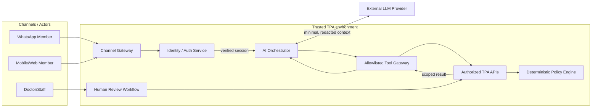

# Diagram 01 — System context / trust boundaries

**Trust boundaries:** The external model is not a trusted authorization engine. The gateway checks identity, backend checks tenant/member scope and applies policy rules. Human doctor decisions remain in trusted business workflow.
