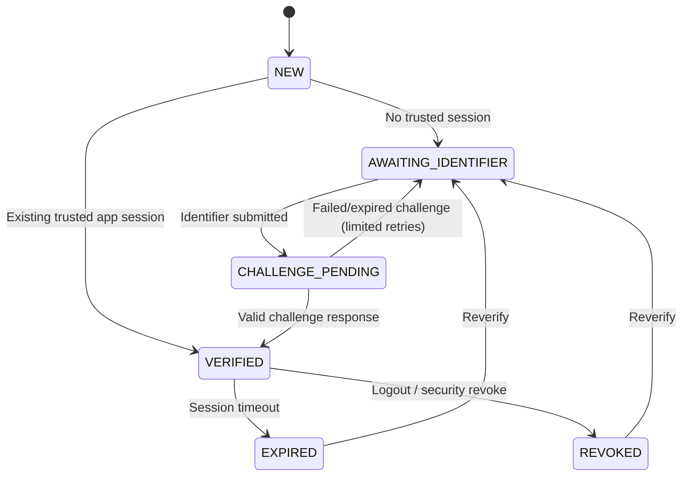
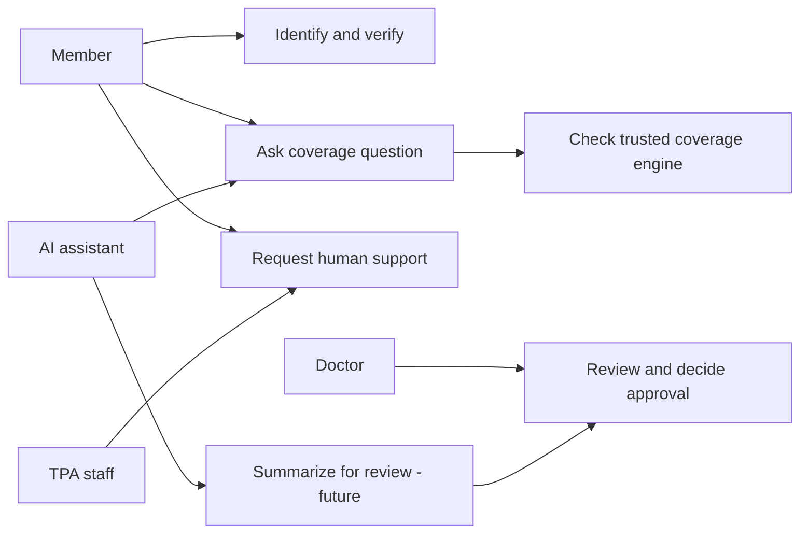

# Diagram 04 — State lifecycle and V1 use cases

## Conversation/session states

## Scope/use-case map

These are conceptual diagrams; not a replacement for agreed TPA product use cases or a full enterprise ERD.
