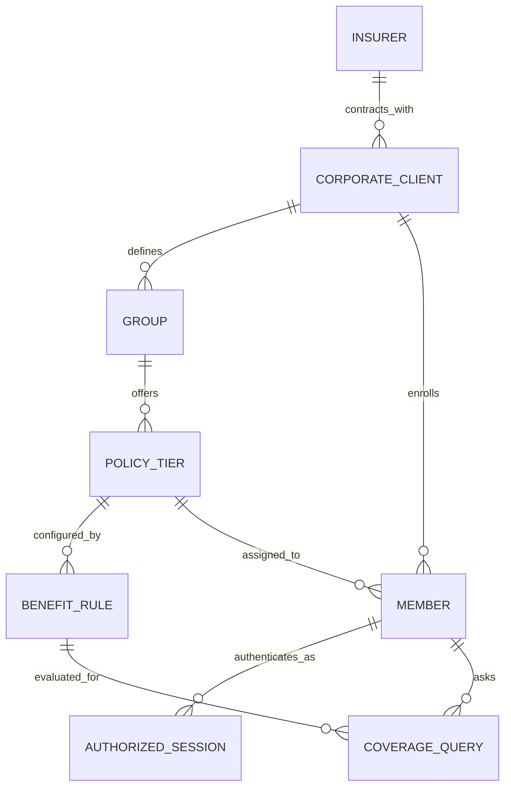

# Diagram 05 — Conceptual data relationships AI depends on

**Conceptual only; NOT a database schema.** Real TPA may require policy history, dependents, overlap rules, endorsements, validity dates, network exclusions and many-to-many relations. Core/backend data architect owns the actual schema; AI team owns tool contracts and least-privilege access.
